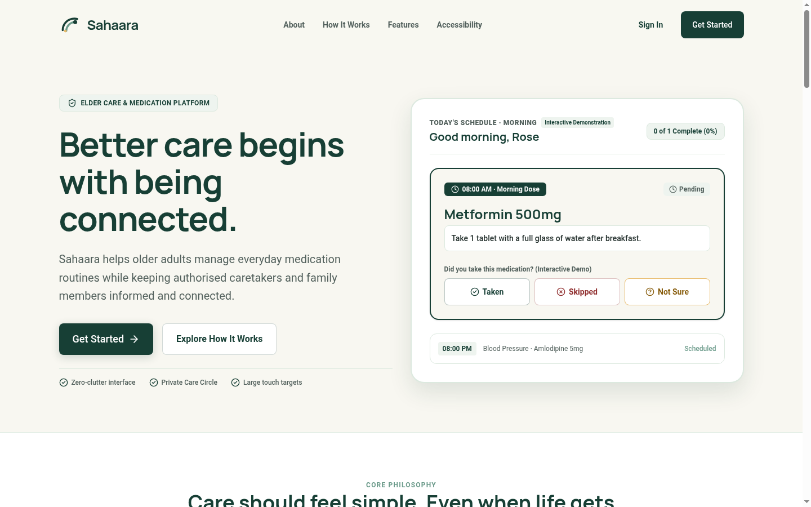
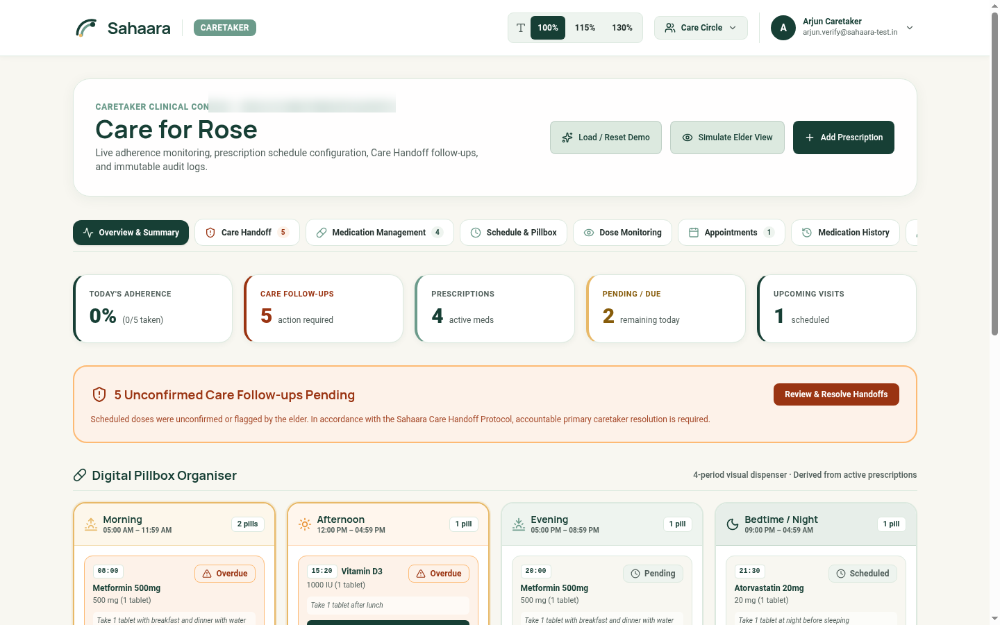
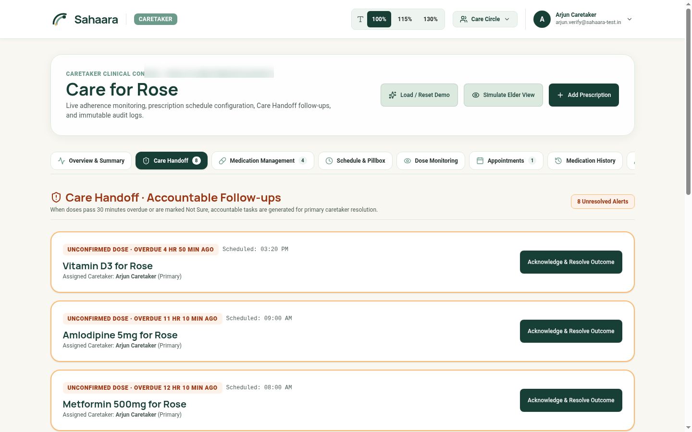
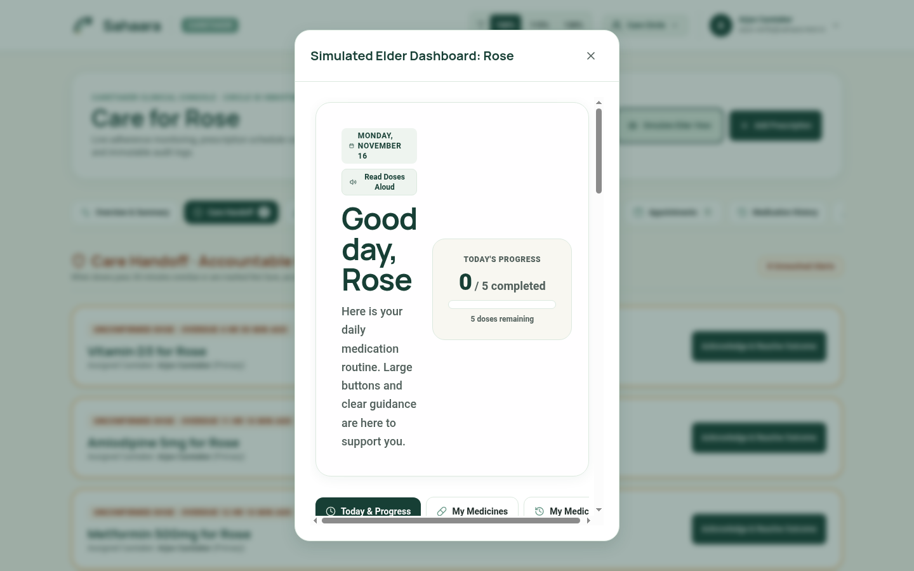

# Sahaara — Elderly Care & Medication Management Platform

> **Live Deployment:** [https://sahaara-5c835.web.app](https://sahaara-5c835.web.app)  
> **Firebase Project ID:** `sahaara-5c835` (Region: `asia-south1` Mumbai)

---

## 1. Project Overview

**Sahaara** (सहारा — *support/solace*) is a healthcare coordination and medication adherence platform built specifically for elderly individuals, primary caretakers, and extended families.

### The Problem
- **Cognitive & Sensory Burden:** Seniors managing multiple chronic conditions (hypertension, diabetes, dyslipidemia) often struggle with complicated pill schedules, small packaging print, and hard-to-read software dashboards.
- **The "Unconfirmed Dose" Black Hole:** Typical pill reminder apps send a generic notification and mark doses "missed" if unopened. In reality, an unconfirmed dose rarely equals defiance or non-adherence; the elder might be sleeping, away from their device, or confused about instructions.
- **Family Coordination Gap:** Adult children frequently feel anxiety about whether their aging parents took their morning blood pressure or cardiac medication, but have no real-time, non-intrusive visibility into daily care.

### The Sahaara Solution
Sahaara unites the elder, their primary caretaker, and their family into an isolated **Care Circle**. Elders enjoy a calm, ultra-accessible interface with 56px action buttons and audio read-aloud support; caretakers gain a clinical console with prescription schedule management and stock tracking; and families receive peaceful, read-only reassurance.

The heart of Sahaara is the **Care Handoff Protocol**—our core differentiator that replaces passive reminders with human-accountable clinical follow-ups.

---

## Platform Preview

> Captured from the live deployment at [sahaara-5c835.web.app](https://sahaara-5c835.web.app) using the built-in demo care circle (Rose / Arjun / Meena). The demo Circle ID is intentionally blurred.

| Landing Page | Caretaker Dashboard |
| :---: | :---: |
|  |  |

| Care Handoff Follow-ups | Elder View Simulation |
| :---: | :---: |
|  |  |

---

## 2. What is a Care Circle?

A **Care Circle** is a private, isolated care enclave scoped to a single elderly individual.

```
                   ┌──────────────────────────────────────┐
                   │             CARE CIRCLE              │
                   │       (Passcode & Role-Protected)    │
                   └──────────────────┬───────────────────┘
                                      │
            ┌─────────────────────────┼─────────────────────────┐
            ▼                         ▼                         ▼
   ┌─────────────────┐       ┌─────────────────┐       ┌─────────────────┐
   │      ELDER      │       │    CARETAKER    │       │     FAMILY      │
   │  Large Buttons  │       │ Clinical Console│       │ Read-Only Calm  │
   │  Audio Readout  │       │ Prescription Mgt│       │ Real-Time View  │
   │  Pillbox View   │       │ Handoff Protocol│       │ Adherence Rate  │
   └─────────────────┘       └─────────────────┘       └─────────────────┘
```

- **Elder:** The central individual receiving care. The elder registers the circle with a secret passcode, or joins an existing one. Their interface focuses on large legible typography, high contrast, audio readout, and simple 3-button dose logging (`I Took It`, `Skip Dose`, `Not Sure`).
- **Primary Caretaker:** The designated healthcare provider, adult child, or professional caregiver. Holds administrative rights to configure prescriptions, manage schedules, track pill inventory, schedule doctor visits, and resolve Care Handoff follow-ups.
- **Family Viewer:** Relatives who need peace of mind. Receives strictly read-only visibility into today's dose adherence, care activities, and upcoming medical visits without write access.
- **Passcode-Based Joining & Cryptographic Isolation:** Circle membership requires an authoritative 6-character Care Circle Passcode, hashed with SHA-256 before verification. Every Firestore document write and query is hard-scoped to `callerMember().circleId == circleId`.

---

## 3. Core Features by Role

### Elder Dashboard (7 Sub-Navigation Sections)
1. **Today & Daily Progress:**
   - Real-time progress bar (`X / Y completed`).
   - Prominent **Next Medication Due Hero Card** with meal instructions.
   - Three large 58px high-contrast accessibility action keys:
     - `I Took It` (Persists dose confirmation).
     - `Skip Dose` (Persists documented clinical skip).
     - `Not Sure` (Immediately triggers caretaker check).
   - **Interactive Demonstration Banner:** Always-available 1-click trigger to load realistic multi-medication demo routines.
2. **My Medicines:**
   - Visual prescription cards detailing dosages, meal instructions, and administration times (read-only for elder safety).
3. **My Medication History:**
   - Chronological log of previous dose events with status badges and actor attribution.
4. **Appointments:**
   - Upcoming clinic visits, doctor names, clinics, and "What to bring" preparation notes.
5. **Care Circle:**
   - Visual directory of verified family members and caretakers supporting the elder.
6. **I Need Help:**
   - One-tap emergency contact card with direct telephone dialling (`tel:`) and urgent help request dispatch.
7. **My Privacy & Access:**
   - Transparent, plain-language explanation of medical data encryption, circle isolation, and role restrictions.
8. **Digital Pillbox Organiser:**
   - Visual 4-period compartment organizer (Morning, Afternoon, Evening, Bedtime) with completion checkmarks.
9. **Accessibility & Audio Read-Aloud:**
   - Native Web Speech API integration (`window.speechSynthesis`) that reads out current adherence and upcoming dose details in natural voice.
   - 100%, 115%, and 130% segmented font-size scaling.

---

### Caretaker Clinical Console (11 Sub-Navigation Sections)
1. **Overview & Adherence Summary:**
   - Key metric cards (Adherence rate %, Unresolved handoffs, Active prescriptions, Pending doses today, Upcoming doctor visits).
   - Active Care Handoff urgency banner.
2. **Care Handoff (Core Differentiator):**
   - Active unconfirmed follow-up cards with elapsed time indicators.
   - Comprehensive resolution modal with 5 clinical outcomes and notes.
   - Reassurance empty-state card ("All Care Handoffs Resolved").
   - Resolution history audit log.
3. **Medication Management:**
   - Full prescription CRUD (add, edit, pause, activate, archive).
   - 24-hour administration time picker with multi-dose capability.
   - Meal timing configuration (`Independent`, `With meal`, `Before meal`, `After meal`).
   - Days-of-week active filter.
4. **Schedule & Pillbox:**
   - Daily schedule timeline coupled with the 4-period Digital Pillbox.
5. **Dose Monitoring:**
   - Real-time table of all doses due today, showing recording actor (`elder` vs `caretaker`) and exact timestamp.
6. **Appointments:**
   - Medical visit scheduler (Doctor, clinic, date, time, location, purpose, prep notes).
   - **Doctor Visit Preparation Checklist:** Interactive, toggleable checklist allowing caretakers to track laboratory logs, prescription renewal questions, and physician topics.
7. **Medication History:**
   - Comprehensive historical table with filter by outcome (`All`, `Taken`, `Skipped`, `Not Sure`).
8. **Care Circle & Permissions:**
   - Directory of circle members with roles, UID references, and permissions.
9. **Reports & Export:**
   - One-click **CSV Report Export** generating downloadable `.csv` files scoped to the Care Circle.
10. **Notifications & Email Status:**
    - Real-time dispatch audit logs with transparent disclosure of in-app fallback status.
11. **Activity & Audit Log:**
    - Immutable, chronological append-only audit trail logging every dose confirmation, appointment change, and handoff resolution.
12. **Pill Stock & Refill Tracking:**
    - Pill inventory counter, remaining days of supply estimate (`stock / dosesPerDay`), `< 7 days` low-stock warning, and 1-click `+ Refill (+30)` button.

---

### Family Dashboard (5 Read-Only Sections)
1. **Family Overview:**
   - Peace-of-mind summary banner, today's adherence completion bar, Digital Pillbox, and today's doses.
2. **Care Timeline:**
   - Real-time read-only stream of all care events.
3. **Upcoming Appointments:**
   - Clinic consultation schedule with preparation instructions.
4. **Alerts & Follow-ups:**
   - Read-only status of care alerts and caretaker resolutions.
5. **Medication History:**
   - Chronological historical log of dose outcomes.
- **Strict Role Enforcement:** Family members cannot add prescriptions, alter schedules, or acknowledge handoffs (enforced at both UI and Cloud Firestore rule levels).

---

## 4. Care Handoff Protocol — Main Differentiator

```
 ┌─────────────────────────────────────────────────────────────┐
 │               CARE HANDOFF PROTOCOL WORKFLOW                │
 └──────────────────────────────┬──────────────────────────────┘
                                │
                                ▼
  [1. Scheduled Dose] ──► 08:00 AM Metformin 500mg
                                │
                                ▼
  [2. Elder Interaction]
         ├── Option A: Elder taps "I Took It" ────────► Status: TAKEN (Handoff avoided)
         ├── Option B: Elder taps "Skip Dose" ────────► Status: SKIPPED (Logged to Audit)
         └── Option C: Elder taps "Not Sure" or ──────► Trigger Care Handoff
                       Dose passes > 30 min Overdue
                                │
                                ▼
  [3. Idempotent Alert Generation]
         └── System creates /careAlerts/{circleId}_{slotId}
             Assigned to: Primary Caretaker
             Status: ACTIVE (Urgent Follow-up)
                                │
                                ▼
  [4. Caretaker Clinical Action]
         └── Caretaker reviews alert in Care Handoff section
             Selects from 5 Clinical Outcomes:
             1. Confirmed Taken (verified on phone/in-person)
             2. Confirmed Skipped (authorized clinical skip)
             3. Refused by Elder (requires medical check)
             4. Still Uncertain (pending lab check)
             5. Unable to Contact Elder
             Adds resolution clinical notes
                                │
                                ▼
  [5. Resolution & Immutable Audit]
         └── Alert moves to RESOLVED
             Appended to /careActivities audit trail with timestamp and caretaker UID
```

*Key Healthcare Principle:* An unconfirmed dose never automatically proves an elder missed medication. It simply means confirmation is absent. Sahaara converts clinical ambiguity into human accountability.

---

## 5. Technology Stack & Google Services

| Layer | Technology | Purpose in Sahaara |
|---|---|---|
| **Frontend Framework** | React 19 + TypeScript | Component architecture, strict type safety, zero-any policy |
| **Build & Tooling** | Vite 8 + Tailwind CSS v4 | Fast HMR, production minification, modern design tokens |
| **Authentication** | Firebase Authentication | Email/password credential auth, persistent session handling |
| **Database** | Google Cloud Firestore | Real-time NoSQL database (Multi-region: `asia-south1` Mumbai) |
| **Hosting & CDN** | Firebase Hosting | Production global edge deployment via Firebase CLI |
| **Security Architecture** | Firestore Security Rules | Least-privilege server-side authorization and circle isolation |
| **Accessibility & Speech** | Web Speech API | Native speech synthesis (`window.speechSynthesis`) for elders |
| **Icons & UI** | Lucide React | High-contrast accessible iconography |

*(Note: In accordance with hackathon guidelines, planned integrations like Gemini AI or Maps are not claimed in this submission because they are not part of the active Phase 1/Phase 2 production release).*

---

## 6. Architecture & Folder Structure

```
Catalyst/Hackathon-Project/
├── .firebaserc                    # Firebase project binding (sahaara-5c835)
├── firebase.json                  # Hosting rewrites and firestore rules configuration
├── firestore.rules                # Production security rules (role-based access)
├── package.json                   # Dependencies & build scripts
├── tsconfig.json                  # Strict TypeScript compiler options
├── eslint.config.js               # ESLint configuration with React hooks & refresh rules
├── public/                        # Public assets (favicons, manifest)
├── test/
│   └── e2e-live.ts                # Full 8-suite live Firestore integration test harness
└── src/
    ├── main.tsx                   # Application bootstrap
    ├── App.tsx                    # Route controller & NavShell wrapper
    ├── index.css                  # Tailwind CSS v4 directives & design tokens
    ├── types/
    │   └── index.ts               # Core TypeScript models (Circle, Member, Medication, DoseSlot, etc.)
    ├── firebase/
    │   └── config.ts              # Firebase client SDK initialization
    ├── context/
    │   ├── AuthContext.tsx        # Authentication state & active member/circle listener
    │   └── RouterContext.tsx      # Lightweight hash/pathname router
    ├── utils/
    │   └── crypto.ts              # Web Crypto API SHA-256 passcode hashing
    ├── services/
    │   ├── activityService.ts     # Immutable care activity audit trail logging & subscription
    │   ├── appointmentService.ts  # Healthcare appointment CRUD & subscriptions
    │   ├── careHandoffService.ts  # Care Alert creation, auto-sync, and caretaker acknowledgement
    │   ├── circleService.ts       # Circle creation, joining, and member subscriptions
    │   ├── contactService.ts      # Public contact inquiries & support ticket persistence
    │   ├── demoService.ts         # Idempotent demo routine seeding (Metformin, Amlodipine, etc.)
    │   ├── doseEventService.ts    # Deterministic dose logging, duplicate prevention & slot calculation
    │   ├── emailService.ts        # Transactional email dispatcher with in-app fallback
    │   ├── medicationService.ts   # Prescription CRUD & active schedule toggling
    │   └── notificationService.ts # Medication & appointment reminder log persistence
    └── components/
        ├── ui/                    # Reusable components (Button, Card, Input, Modal, StatusBadge, DigitalPillbox, NavShell)
        ├── public/                # Public landing page, FAQ, Contact pages
        ├── auth/                  # Split-screen authentication & passcode joining pages
        ├── elder/                 # ElderDashboard (7 sections, next dose hero, 56px action keys)
        ├── caretaker/             # CaretakerDashboard (11 clinical sections, handoff modal, CSV export)
        └── family/                # FamilyDashboard (5 read-only reassurance sections)
```

---

## 7. Security & Privacy Architecture

Sahaara adheres strictly to healthcare least-privilege security principles:

1. **Circle Data Isolation:**
   Every document in `medications`, `doseEvents`, `appointments`, `careAlerts`, and `careActivities` contains a `circleId` attribute. Firestore rules enforce:
   ```
   callerMember().circleId == resource.data.circleId
   ```
   Users cannot read or query data from any circle other than their own.
2. **Server-Side Role Separation:**
   - **Elders & Caretakers:** Permitted to record dose events and schedule appointments.
   - **Caretakers:** Sole authority to add, update, or archive medications, and resolve Care Handoff follow-ups.
   - **Family Viewers:** Enforced **read-only** by Firestore security rules. Any attempt to write a medication, appointment, or dose status results in immediate `PERMISSION_DENIED` (verified in automated live test suite 7).
3. **Immutable Audit Trail:**
   The `careActivities` collection permits document creation by circle members, but **strictly forbids `update` and `delete`**. Historical records cannot be altered or purged by ordinary users.
4. **Deterministic Idempotency:**
   Dose events are keyed as `${medicationId}_${scheduledAtISO}`. Repeated button taps or network retries merge into the single canonical document, guaranteeing zero duplicate dose records.

---

## 8. Installation & Local Setup

### Prerequisites
- Node.js 20+ installed
- npm or pnpm

### Steps

1. **Clone Repository:**
   ```bash
   git clone https://github.com/Prasannas19/Sahaara.git
   cd sahaara
   ```

2. **Install Dependencies:**
   ```bash
   npm install
   ```

3. **Configure Environment:**
   Create a `.env` file (or use the pre-configured Firebase project settings):
   ```env
   VITE_FIREBASE_API_KEY=your-api-key
   VITE_FIREBASE_AUTH_DOMAIN=your-project.firebaseapp.com
   VITE_FIREBASE_PROJECT_ID=your-project-id
   VITE_FIREBASE_STORAGE_BUCKET=your-project.firebasestorage.app
   VITE_FIREBASE_MESSAGING_SENDER_ID=your-sender-id
   VITE_FIREBASE_APP_ID=your-app-id
   ```

4. **Run Development Server:**
   ```bash
   npm run dev
   ```
   Open `http://localhost:5173` in your browser.

5. **Run Linting & Tests:**
   ```bash
   npm run lint
   npm test
   ```

6. **Create Production Build:**
   ```bash
   npm run build
   ```

---

## 9. Testing & Verification

Sahaara includes both offline logic unit tests and a live end-to-end integration test harness executing real operations against Cloud Firestore.

### 1. Offline Logic Unit Tests (`npm test`)
Executes `src/services/doseEventService.test.ts`:
- Deterministic event ID generation and repeatable keying.
- Multi-medication slot computation and weekday filtering.
- 30-minute overdue slot classification.
- Dose event status mapping.

### 2. Live Integration Suite (`npx tsx test/e2e-live.ts`)
Executes 8 live verification suites against production Firestore:
1. **Elder Registration & Circle Creation:** Verifies user creation, circle creation, and authoritative `members/{uid}` document.
2. **Caretaker Registration & Joining:** Verifies SHA-256 passcode verification and circle binding.
3. **Medication Management:** Verifies real Firestore prescription creation and retrieval.
4. **Appointment Management:** Verifies visit scheduling, audit logging, and completion.
5. **Care Handoff Protocol:** Verifies idempotent alert generation and caretaker acknowledgement.
6. **Elder Dose Status Logging:** Verifies `Taken`, `Skipped`, and `Not Sure` persistence, plus deterministic duplicate prevention.
7. **Family Viewer Read-Only Security:** Verifies that read access is allowed, but write attempts to medications or appointments are rejected with `PERMISSION_DENIED`.
8. **Stage 2 Regression Verification:** Verifies demo routine deduplication, real-time activity log sorting, and overdue alert auto-synchronisation.

### 3. Production Build Check (`npm run build`)
Executes `tsc -b && vite build` verifying zero TypeScript compilation errors and bundle minification.

---

## 10. Deployment

Sahaara is hosted on **Firebase Hosting** with global SSL and CDN delivery.

- **Production URL:** [https://sahaara-5c835.web.app](https://sahaara-5c835.web.app)
- **Deployment Command:**
  ```bash
  npm run deploy          # Deploys hosting bundle
  npm run deploy:rules    # Deploys Firestore security rules
  ```

---

## 11. Current Limitations & Future Scope

In the spirit of complete engineering honesty, the following items represent intentional scope boundaries for this release:

1. **Email Delivery Fallback:** Automated reminder logs are recorded and displayed in-app; external SMTP delivery operates in in-app fallback mode unless an external email provider is configured.
2. **Excluded Features (Not in this release):**
   - Gemini / Google AI integration.
   - Voice command transcription.
   - Google Maps transit directions to clinics.
   - Automated secondary caretaker escalation timers (excluded per spec).
   - Complex tapering dosage calculations.

---

## 12. Project Impact

Sahaara provides real healthcare impact by directly addressing the three pillars of home elderly care:
1. **Elder Independence:** Seniors are empowered by intuitive, accessible interfaces with audio read-aloud support and big touch targets, removing fear of software mistakes.
2. **Caretaker Efficacy:** Caretakers transition from anxious guesswork to accountable, structured oversight with automated overdue detection and inventory refill alerts.
3. **Family Serenity:** Distance-separated families receive real-time visibility into their loved one's wellness, preserving dignity while ensuring safety.

---
*Developed for the Google Cloud & Firebase Hackathon 2026.*

